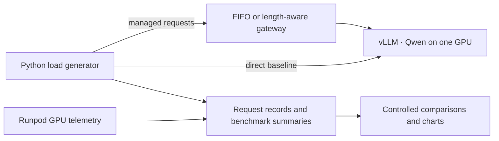

# Inference Load Lab

A small LLM serving and benchmarking project built around vLLM.

Compare streaming requests sent directly to a Qwen model on a Runpod GPU Pod
with requests admitted through a bounded gateway using FIFO or length-aware
scheduling.



## Send a request

Install the locked Python environment:

```bash
uv sync --locked
```

Deployment setup stores the server URL, model alias, and generated API key in
`.env.local`. That file is private and ignored by Git. On another machine, copy
`.env.example` to `.env.local` and fill in the connection details.

```bash
uv run --env-file .env.local inference-load-lab
```

Choose a prompt and output limit:

```bash
uv run --env-file .env.local inference-load-lab \
  --prompt "Explain continuous batching in two sentences." \
  --max-tokens 128
```

The client prints the generated text as it arrives, followed by a JSON summary:

- `ttft_ms`: time from request start to the first nonempty generated content.
- `e2e_ms`: time from request start to the stream's `[DONE]` event.
- `tpot_ms`: `(e2e_ms - ttft_ms) / (output_tokens - 1)` when at least two
  output tokens and visible content are available; otherwise `null`.
- `output_tokens`: the server's reported completion-token count.
- `finish_reason`: why generation stopped, such as `stop` or `length`.
- `queue_wait_ms`: time waiting for gateway admission, or `null` on the direct path.
- `request_manager`: the gateway's reported admission settings, when present.

These are client-observed timings. They include the network and Runpod proxy.
The first visible content is a practical TTFT proxy, and a streaming chunk can
contain multiple tokens. The client uses the server's token count rather than
counting chunks. An interrupted stream is reported as a failure.
TPOT is a client-observed average over the response after first content, including
network delivery and the final stream event. It does not measure individual
token gaps. One-token outputs and missing usage are excluded from TPOT summaries.

## Run a load test

Start with one concurrency level:

```bash
uv run --env-file .env.local inference-load-lab bench \
  --requests 100 --concurrency 4 --warmup 5 --max-tokens 128 \
  --server-config configs/vllm.json
```

Run the baseline sweep with the included prompt set:

```bash
uv run --env-file .env.local inference-load-lab bench \
  --requests 100 --concurrency 1 2 4 8 16 --warmup 16 \
  --prompts-file data/prompts.jsonl --max-tokens 128 \
  --server-config configs/vllm.json
```

`--requests` is the number of measured requests **at each concurrency level**.
The sweep above sends 500 measured requests and 80 warmup requests. Levels run
sequentially. A fixed number of workers continuously send requests as previous
ones finish, reusing one HTTP client and its connection pool. This is a
closed-loop concurrency test; the offered request rate depends on response time.

Each level replays the same balanced, seeded prompt sequence. Supply repeatable
`--prompt` flags or a JSONL file containing strings or `{"prompt": "..."}` objects.
Use `--seed` to change the measured prompt order, and `--timeout` to set the total
deadline for each request, including its streamed response.

Warmups finish before measurement starts and are excluded from every reported
latency and throughput metric. Choose enough warmup requests to cover your prompt
set and concurrency. Warmups and repeated prompts can populate vLLM's prefix
cache: the default repeated-prompt test is a warm-prefix workload. Keep the
prompts, generation limits, cache policy, hardware, and server settings consistent
when comparing runs. The supplied server config is recorded as declared settings,
not queried from the live server.

The terminal reports successful and failed requests, p50/p95 TTFT and end-to-end
latency, p50/p95 gateway queue wait, and aggregate output tokens per second. Queue
wait is `n/a` on the direct path. Latency percentiles use successful
requests only, with linear interpolation at `(n - 1) * quantile`. Throughput is
the sum of successful requests' output tokens divided by the measured wall time
from launching the workers until they all finish, including failed requests' time.
It is not the average of individual requests' token rates. If any successful
request lacks a token count, output-token throughput is reported as `n/a`.
TPOT p50/p95 is calculated across eligible successful requests. These are
percentiles of each request's average TPOT.

Every invocation creates a new, Git-ignored `results/<UTC timestamp>/` directory:

- `config.json`: workload, prompts and their hash, seed, versions, Git state,
  and optional declared server settings. The API key is excluded.
- `requests.jsonl`: one record per completed request, including its phase
  (`warmup` or `measured`), concurrency, request ID, prompt index, timings, token
  count, finish reason, gateway settings, and error details. Generated text is not
  printed or saved.
- `summary.json`: metrics for each level and the overall completion status.
  `request_manager_configs` records the admission settings actually reported by
  the gateway for each level; the direct path reports an empty list.

Use `--output-dir results/my-run` to name a new directory. Existing directories
are refused to protect earlier results. Failed warmups stop the sweep before
measured load; measured request failures are recorded and the command exits
nonzero after the sweep. Ctrl+C preserves completed requests and marks the run as
interrupted. Requests are not automatically retried.

## Arrival-rate and burst tests

Concurrency mode remains the default. To schedule arrivals independently of
response completion, use `--mode rate` or `--mode burst`.

Schedule eight requests per second:

```bash
uv run --env-file .env.local inference-load-lab bench \
  --mode rate --request-rate 8 --requests 100 --max-in-flight 128 \
  --warmup 16 --prompts-file data/prompts.jsonl --max-tokens 128 \
  --server-config configs/vllm.json
```

Schedule bursts of 16 requests, one second apart:

```bash
uv run --env-file .env.local inference-load-lab bench \
  --mode burst --burst-size 16 --burst-interval 1 --requests 100 \
  --max-in-flight 128 --warmup 16 --prompts-file data/prompts.jsonl \
  --max-tokens 128 --server-config configs/vllm.json
```

Add `--base-url http://127.0.0.1:8080` to run either workload through a running
FIFO gateway. `--requests` is the total number of scheduled arrivals in these
modes; each invocation runs one arrival schedule. `--concurrency` applies only
to concurrency mode. Warmups use a separate, unmeasured batch with up to 16
simultaneous requests, bounded by `--max-in-flight`.

The schedules are deterministic. Rate mode schedules request `i` at `i / rate`
seconds. Burst mode schedules it at `floor(i / burst_size) * burst_interval`.
The first arrival is at zero; a final partial burst contains only the remaining
requests. These are fixed intervals, rather than Poisson arrivals. Prompt order
is still balanced and shuffled with the configured seed.

The driver does not wait for earlier responses before processing later arrivals.
`--max-in-flight` bounds its outstanding requests. If this cap is reached, the
arrival is recorded as `dropped` and is not sent or silently held in a client
queue. Use a sufficiently high cap when evaluating server overload, and inspect
driver drops and dispatch lag to check whether the client kept up with the
requested schedule.

Per-request records add:

- `scheduled_offset_s`: the intended arrival time relative to the run start.
- `started_offset_s`: actual request-task start; `null` for a driver drop.
- `dispatch_lag_ms`: actual start minus scheduled arrival; `null` for a drop.
- `arrival_e2e_ms`: scheduled arrival to completion, including driver lag and
  client response handling. Existing `e2e_ms` and `ttft_ms` retain their
  request-dispatch timing definitions.
- `http_status` and structured error details, including upstream error types
  such as `queue_full` when the server supplies one.

Summaries report successful, failed, and driver-dropped requests separately,
HTTP status counts, error types, dispatch-lag percentiles and maximum,
arrival-to-completion percentiles, and peak driver in-flight requests.
`completed_requests` counts sent requests that finished; `recorded_requests`
also includes driver drops. Dropped arrivals have no fabricated zero latency.
The command exits nonzero for either failures or drops, while retaining results.
An HTTP `429` is a server response, distinct from a driver-capacity drop.

Measured duration and throughput include the time to drain outstanding requests
after the final arrival. `arrival_span_s` records the last scheduled offset; it
is not a latency or the total drain time. A configured request rate is a target,
not a guarantee that a saturated client dispatched on time. Check the recorded
lag rather than inferring arrival accuracy from completion throughput.

## FIFO request manager (default)

By default, the gateway queues chat-completion requests in FIFO order and admits at
most a configured number of active requests to **one** upstream vLLM server. An
active slot is held until the upstream response is closed, including its stream.
FIFO controls admission order; responses can finish in a different order.

In terminal 1, from the project directory:

```bash
uv run --env-file .env.local inference-load-lab serve \
  --concurrency 4 --queue-size 64 --queue-timeout 30 --upstream-timeout 120
```

This starts one process at `http://127.0.0.1:8080`. `VLLM_BASE_URL` continues to
point to the GPU server. The default gateway client key is `VLLM_API_KEY`; set
`GATEWAY_API_KEY` to use a separate key, and give that key to clients as their
`VLLM_API_KEY`. The upstream always receives the server's own key.

In terminal 2, send a request through the gateway:

```bash
uv run --env-file .env.local inference-load-lab \
  --base-url http://127.0.0.1:8080 --prompt "Explain KV caching in two sentences."
```

For a comparison, run the same workload on both paths while the gateway is up:

```bash
uv run --env-file .env.local inference-load-lab bench \
  --requests 100 --concurrency 16 --warmup 16 --max-tokens 128 \
  --prompts-file data/prompts.jsonl --server-config configs/vllm.json \
  --output-dir results/direct

uv run --env-file .env.local inference-load-lab bench \
  --base-url http://127.0.0.1:8080 \
  --requests 100 --concurrency 16 --warmup 16 --max-tokens 128 \
  --prompts-file data/prompts.jsonl --server-config configs/vllm.json \
  --output-dir results/fifo-c4
```

Use new output directory names for subsequent comparisons. The gateway's limit
of four active requests is separate from the load generator's 16 simulated users;
the remaining requests wait for admission. Compare errors and throughput alongside
latency: adding a queue can increase latency or reduce throughput. Repeat runs
with the same workload and alternate their order before drawing conclusions.
Use the arrival-rate and burst modes to study overload at a fixed offered
workload, and retain rejection and driver-drop counts alongside latency.

Queue wait is measured at the gateway from requesting admission until a slot is
granted. It is returned in `X-Queue-Wait-Ms`. `X-Request-Manager` carries the
admission configuration recorded by the client. Client TTFT and end-to-end latency
include this wait plus the remaining network and server work. vLLM's internal
scheduler wait remains part of those client timings.

The gateway handles:

- A full waiting queue with HTTP `429` and a `Retry-After` header.
- A queue timeout with HTTP `504`, without forwarding that request upstream.
- Upstream connection errors with `502`, and upstream timeouts with `504` before
  streaming starts. Errors after streaming starts are sent as SSE error events
  and are recorded as failed requests by the client.
- Disconnected or cancelled clients by removing queued work or closing the
  upstream response and releasing its active slot.
- Authentication before admission, and a 1 MiB request-body limit.

`GET /health` checks that the gateway is alive. Authenticated `GET /stats` reports
its active and queued counts and settings. Authenticated `GET /v1/models` forwards
the upstream model list. `POST /v1/chat/completions` supports streamed and ordinary
JSON responses. The gateway uses one process with an in-memory queue; it does not
route work across multiple model servers. Ctrl+C allows up to ten seconds for
graceful shutdown before outstanding requests are cancelled.

## Length-aware scheduling

An optional policy selects the queued request with the smallest estimated cost.
Equal costs retain arrival order. Once a request has waited for the configured
aging threshold, aged requests are admitted in arrival order ahead of ordinary
cost-based work. Requests already running keep their slots until their streams
finish; this policy changes admission order.

```bash
uv run --env-file .env.local inference-load-lab serve \
  --policy length-aware --aging-seconds 30 \
  --concurrency 16 --queue-size 512 --queue-timeout 120 --upstream-timeout 120
```

The cost proxy is `ceil(UTF-8 message-content bytes / 4) + output-token budget`.
This is a cheap ordering heuristic, not the model's tokenizer or a prediction of
the actual completion length. It uses `max_completion_tokens` when present,
otherwise `max_tokens`; missing budgets receive a conservative cost of 4096
output tokens. The policy supports string text-message content and rejects
unsupported content before admission. FIFO preserves its existing pass-through
behavior. The default aging threshold is 10 seconds; it must be less than the
queue timeout. The controlled experiment below uses 30 seconds.

Promotion changes which waiting ticket wins the next free slot. It does not
guarantee admission exactly at the threshold: active streams and older promoted
requests can still be ahead. The queue remains bounded, and timeout, cancellation,
disconnect handling, and stream-lifetime slot ownership apply to both policies.
Successful responses carry arrival/admission order, estimated cost, and whether
aging promoted the request. These are saved with the benchmark records.

Mixed-workload JSONL can specify each prompt's class and output budget:

```json
{"prompt":"Define KV caching.","class":"short","max_tokens":32}
{"prompt":"Explain an inference server in detail.","class":"long","max_tokens":512}
```

An entry's budget overrides `--max-tokens`; absent budgets use the CLI default.
The included `data/mixed-prompts.jsonl` contains eight short and two long entries.
Class summaries use only measured records and report latency, queue wait, token
counts, failures, drops, and aging promotions. Each class's throughput uses the
same full-run wall-time denominator as overall throughput.

```bash
uv run --env-file .env.local inference-load-lab experiment \
  --config configs/scheduling-experiment.json --gpu-pod-id YOUR_POD_ID \
  --output-dir results/scheduling-comparison

uv run --extra analysis inference-load-lab analyze results/scheduling-comparison
```

This comparison holds admission concurrency at 16 for both policies. It uses
four paired trials, two in each order. Each run schedules 300 arrivals as five
bursts of 60, one second apart: 240 short requests generating 32 tokens and
60 long requests generating 512 tokens. `ignore_eos=true` fixes those decode
lengths for 38,400 measured tokens per run. The driver cap and queue capacity
are both 512. Each run has 32 excluded warmups.

The prespecified target is short-request p95 end-to-end latency. The analyzer
reports changes for short requests alongside long-request latency and overall
throughput. A targeted latency improvement can have a throughput or long-request
trade-off; it is reported separately from the earlier uniform-workload admission
concurrency experiment. `class-latencies.png` shows both classes and
`admission-order.png` shows actual arrival and admission ranks.

## GPU utilization

Opt in to GPU sampling when benchmarking a Runpod server:

```bash
uv run --env-file .env.local inference-load-lab bench \
  --requests 100 --concurrency 16 --warmup 16 \
  --gpu-pod-id YOUR_POD_ID --gpu-interval 2
```

The collector uses `RUNPOD_API_KEY`, or the existing `runpodctl` credential in
`~/.runpod/config.toml`. This is separate from the vLLM bearer key.
It reads the named pod's timestamped `latestTelemetry.individualGpuMetrics`
through Runpod's [documented GraphQL schema](https://graphql-spec.runpod.io/).
Only the named pod's GPU IDs, reported utilization, provider uptime, provider
sample timestamps, and poll timestamps are saved in `gpu.jsonl`.
Inference and telemetry use separate HTTP
connection pools.

Sampling starts after warmup and stops with the measured load. The summary gives
the arithmetic mean and maximum of unique provider samples for each GPU, poll
failures, and coverage. Provider timestamps determine whether a sample falls
inside the measured window. Older and newer samples are retained in the raw
file and excluded from the summary; repeated timestamps are counted once.
A response received after the window can contain a valid sample taken inside
it. Unavailable samples produce an explicit status rather than a fabricated zero.

These are provider-reported snapshots, with provider-dependent update timing.
Repeated polls can observe the same underlying measurement; a two-second polling
interval does not imply two-second hardware resolution. Execution utilization
does not describe GPU occupancy or model FLOPS efficiency. The vLLM setting
`--gpu-memory-utilization` controls memory allocation and is recorded separately.

## Controlled admission experiment

Install the optional plotting dependencies:

```bash
uv sync --locked --extra analysis
```

Run the checked-in comparison plan:

```bash
uv run --env-file .env.local inference-load-lab experiment \
  --config configs/admission-experiment.json \
  --gpu-pod-id YOUR_POD_ID \
  --output-dir results/admission-comparison

uv run inference-load-lab analyze results/admission-comparison
```

The experiment starts and stops temporary local gateways automatically. Its
three variants are direct vLLM, FIFO concurrency 4, and FIFO concurrency 16.
The prespecified baseline is FIFO 4 and the candidate is FIFO 16. Each variant
runs three times, rotating its position in the sequence to balance run order.
Every run uses client concurrency 32, 300 measured requests, 32 excluded warmups,
the same five prompts and seed, and a 128-token output budget. The vLLM extension
`ignore_eos=true` makes this a fixed-length decode workload. All nine runs send
2,700 measured requests and 288 warmups. The longer run windows allow for the
provider's coarse telemetry refresh cadence. The FIFO queue size stays at 128, and
the vLLM server's sequence limit stays at 16. Admission concurrency is the
parameter under comparison.

Apply the candidate's admission settings to an interactive gateway with:

```bash
uv run --env-file .env.local inference-load-lab serve \
  --concurrency 16 --queue-size 128 --queue-timeout 120 --upstream-timeout 120
```

The primary metric is per-run p95 end-to-end latency. The analysis pairs the
baseline and candidate within each trial, reports each paired percentage change,
and takes the median across trials. Throughput, TTFT, TPOT, queue wait, errors,
drops, and GPU samples remain available alongside that metric. Before reporting
a consistent improvement, it checks workload and declared server settings,
actual gateway limits, completed-request counts, matching output-token counts
per request, GPU identity, and at least one fresh unique GPU sample per run.
The candidate must reduce p95
latency and maintain or increase throughput in every paired trial. Failed
comparisons retain their data and explain which checks failed.

Outputs include all per-run configs, request records and summaries, raw GPU
samples, vLLM `/metrics` snapshots, run order, and source-file hashes. Analysis
exports `comparison.json`, `trials.csv`, `latency-throughput.png`, and
`gpu-utilization.png`. Use `analyze --no-plots` for numeric exports without the
plotting extra. Existing output directories are refused. Ctrl+C preserves
partial results and shuts down the current temporary gateway.

The default experiment uses repeated prompts with a warm prefix cache. Its
results describe this workload, hardware, server configuration, and network
path. Three trials show observed variation; their minimum and maximum are not
confidence intervals. The direct route provides context for the cost of gateway
admission. Admission tuning should be repeated for different request lengths,
arrival rates, and service targets.

Saved experiment artifacts are indexed in [reports/README.md](reports/README.md).

## Server configuration

- Model: `Qwen/Qwen3-4B-Instruct-2507` (public, BF16 weights).
- Model revision: `cdbee75f17c01a7cc42f958dc650907174af0554`.
- vLLM image: `vllm/vllm-openai:v0.11.2`, pinned by digest at deployment.
- API model alias: `qwen3-4b`.
- Context limit: 4,096 tokens, shared by the prompt and output.
- Maximum scheduled sequences: 16.
- GPU memory utilization setting: 0.90.
- The HTTP API listens on `0.0.0.0:8000` and requires a generated bearer key.

`configs/vllm.json` records the exact image digest and launch arguments. Keep
these fixed while comparing the direct-server and FIFO-queue experiments.

vLLM downloads the public model directly from Hugging Face when it starts.
Hugging Face MCP is useful for inspecting the Hub; downloading this public model
does not require a Hugging Face login.

The local `.local/deployment.json` records the Pod ID, image digest, model
revision, and launch arguments after a successful create. No network volume is
created by this setup; cached weights on container disk must be downloaded again
after stopping the Pod.

On a Linux NVIDIA GPU host with Docker, NVIDIA Container Toolkit, and a driver
supporting CUDA 12.9, launch the same pinned image and model arguments with:

```bash
uv run --env-file .env.local python scripts/serve_vllm.py
```

The script reads `configs/vllm.json`, passes the API key through the environment,
binds the API to local port 8000, and uses a named model-cache volume. Set
`VLLM_BASE_URL=http://127.0.0.1:8000` for clients on that host. Use
`--print-command` to inspect the command without starting Docker. On Runpod,
use the image, arguments, CUDA floor, and environment-variable names in
`configs/vllm.json`; expose `8000/http` and obtain the pod's proxy URL.

## Checks

```bash
uv run ruff check .
uv run ruff format --check .
uv run pytest -q
uv build
```

The tests cover streamed content and metadata, accurate use of the server's
token count, HTTP errors, in-stream errors, and truncated responses. They do not
need a GPU.
Benchmark tests also check bounded concurrency, warmup exclusion, repeatable
workloads, timeout and error reporting, percentile and throughput calculations,
and a full CLI run against a local streaming HTTP server.
Admission tests cover FIFO order, bounded capacity, timeout and cancellation
cleanup, and stream lifetime. An integration test runs the benchmark CLI through
a real local HTTP gateway and mock upstream, checking its concurrency limit and
queue-wait measurements without using a GPU.
Arrival-mode tests check that requests continue arriving while earlier responses
are blocked, that the driver cap drops rather than queues excess arrivals, and
that both new CLI modes work through the real local HTTP gateway.
Tests also exercise the full repeated-experiment CLI against a local streaming
server, verify temporary gateway cleanup, and reject comparisons with changed
workloads, token counts, admission limits, or missing GPU telemetry. GitHub
Actions runs the locked environment, checks, tests, and package build without
GPU credentials.

The metric definitions and vLLM-specific request parameters follow the pinned
[vLLM metrics documentation](https://docs.vllm.ai/en/v0.11.2/design/metrics/)
and [request protocol](https://docs.vllm.ai/en/v0.11.2/api/vllm/entrypoints/openai/protocol/).
